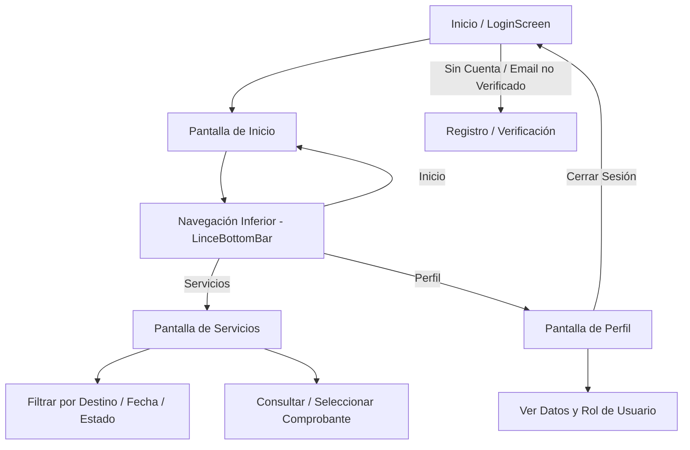
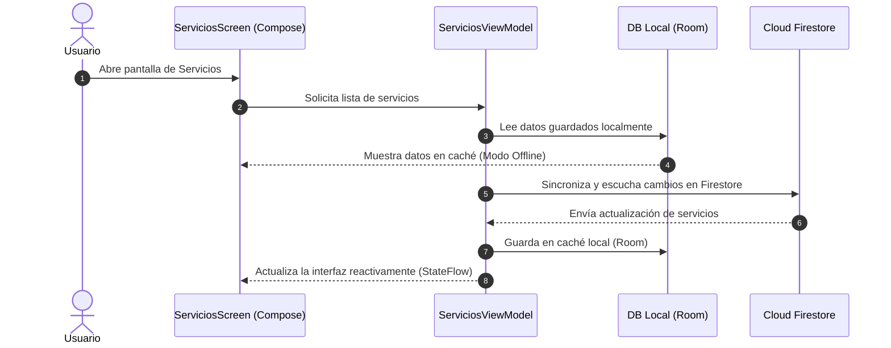
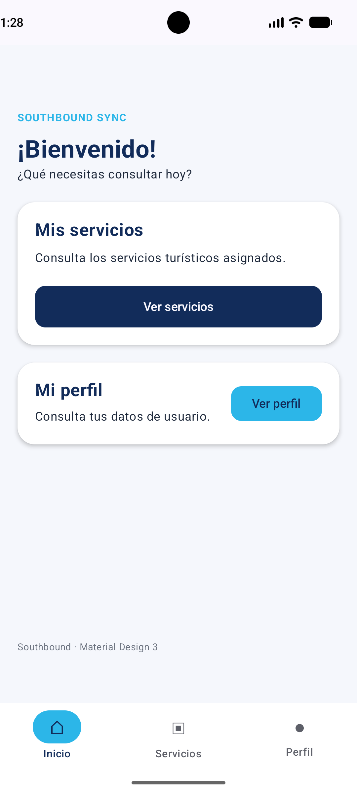
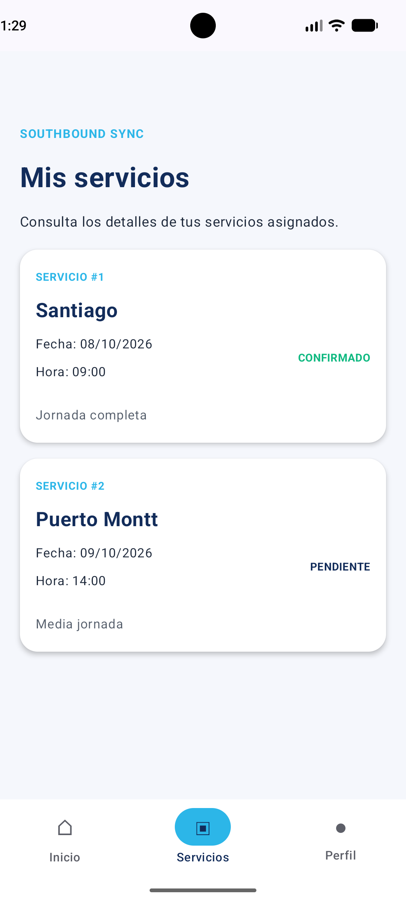
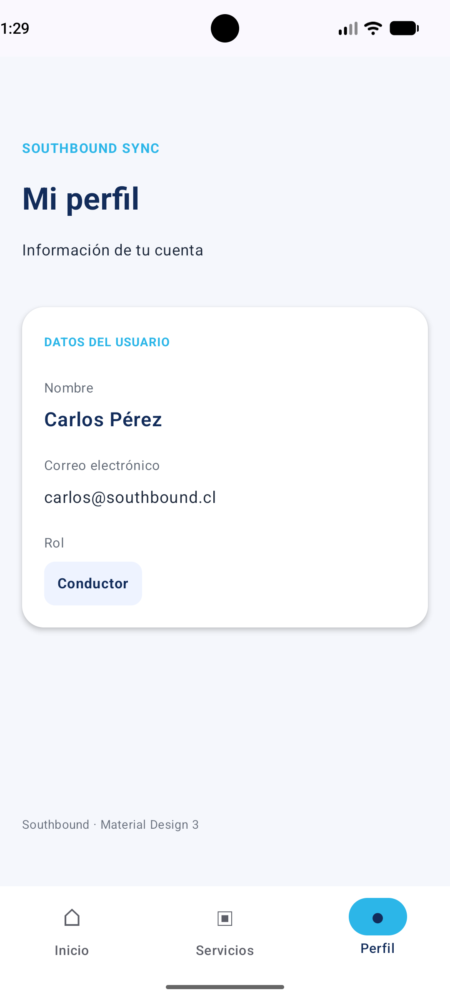

# Proyecto Lince — Southbound Sync

## 1. Descripción del proyecto

**Southbound Sync** es una aplicación móvil desarrollada para los trabajadores de **Southbound**, empresa dedicada a servicios turísticos.

El propósito de la aplicación es facilitar la organización, coordinación y consulta de servicios turísticos, permitiendo que los trabajadores accedan a la información relacionada con sus asignaciones desde un dispositivo Android.

La aplicación contempla tres roles principales:

- **Driver (Conductor)**
- **Guía**
- **Coordinador**

Actualmente, Southbound Sync permite iniciar sesión, consultar el perfil del trabajador, revisar servicios asignados, utilizar filtros de búsqueda y conservar información localmente para situaciones sin conexión a internet.

Este proyecto se desarrolla como parte de la asignatura **Desarrollo de Aplicaciones Móviles**, en el contexto de Vinculación con el Medio (VcM).

---

## 2. Objetivo

### Objetivo general

Desarrollar una aplicación móvil que facilite la coordinación y consulta de servicios turísticos, mejorando el acceso a la información de los trabajadores de Southbound.

### Objetivos específicos

- Centralizar la información de los servicios turísticos.
- Permitir el acceso mediante cuentas de usuario.
- Identificar a los trabajadores según su rol.
- Consultar los servicios asignados a cada trabajador.
- Visualizar destinos, fechas, horarios y estados.
- Implementar búsquedas y filtros.
- Mantener información disponible sin conexión a internet.
- Incorporar herramientas nativas de Android.
- Mejorar la organización de los traslados turísticos.

---

## 3. Tecnologías utilizadas

El proyecto fue desarrollado utilizando las siguientes tecnologías:

| Tecnología | Función |
|------------|---------|
| Kotlin | Lenguaje de programación |
| Android Studio | Entorno de desarrollo |
| Jetpack Compose | Construcción de interfaces |
| Material Design 3 | Diseño de componentes visuales |
| Navigation Compose | Navegación entre pantallas |
| MVVM | Arquitectura del proyecto |
| ViewModel | Gestión de lógica y estados |
| StateFlow | Actualización reactiva de información |
| Firebase Authentication | Autenticación de usuarios |
| Cloud Firestore | Base de datos en la nube |
| Room (SQLite) | Persistencia de datos local |
| Repository | Coordinación entre fuentes de datos |
| Git | Control de versiones |
| GitHub | Repositorio y colaboración |

---

## 4. Arquitectura del proyecto

Southbound Sync utiliza una arquitectura basada en **MVVM (Model-View-ViewModel)** para organizar el código y separar las responsabilidades.

### Model

Representa los datos que utiliza la aplicación.

Clases principales:

- `Usuario.kt`
- `Servicio.kt`
- `ServicioEntity.kt`

### View

Corresponde a las pantallas desarrolladas mediante Jetpack Compose y Material Design 3.

Pantallas principales:

- Login
- Inicio
- Servicios
- Perfil

### ViewModel

Administra los estados y la información utilizada por las pantallas.

Se implementa **StateFlow** para actualizar los datos de manera reactiva.

Archivos:

- `LinceViewModel.kt`
- `ServiciosViewModel.kt`

### Repository

Se encarga de coordinar el acceso a las fuentes de información.

`ServicioRepository.kt` permite trabajar con Cloud Firestore y Room.

### Persistencia local

La aplicación utiliza Room para almacenar una copia de los servicios turísticos en el dispositivo.

Componentes:

- `ServicioEntity.kt`
- `ServicioDao.kt`
- `LinceDatabase.kt`

### Estructura principal

    cl.duoc.proyectolince
    |
    +-- local
    |   +-- LinceDatabase.kt
    |   +-- ServicioDao.kt
    |   +-- ServicioEntity.kt
    |
    +-- model
    |   +-- Usuario.kt
    |   +-- Servicio.kt
    |   +-- LinceUiState.kt
    |
    +-- navigation
    |   +-- LinceNavigation.kt
    |
    +-- repository
    |   +-- ServicioRepository.kt
    |
    +-- ui
    |   +-- components
    |   |   +-- LinceBottomBar.kt
    |   |
    |   +-- screens
    |   |   +-- LoginScreen.kt
    |   |   +-- InicioScreen.kt
    |   |   +-- ServiciosScreen.kt
    |   |   +-- PerfilScreen.kt
    |   |
    |   +-- theme
    |
    +-- viewmodel
    |   +-- LinceViewModel.kt
    |   +-- ServiciosViewModel.kt
    |
    +-- MainActivity.kt

    ### Flujo de navegación y de información

#### Flujo de Navegación de la Aplicación

### Flujo de información

La aplicación obtiene la información desde Firebase y la conserva localmente mediante Room.

    Firebase Firestore
            |
            v
    ServicioRepository
            |
            v
       Room (SQLite)
            |
            v
     ServiciosViewModel
            |
            v
         StateFlow
            |
            v
      ServiciosScreen

Este funcionamiento permite que la interfaz muestre los servicios almacenados y se actualice cuando cambie la información disponible.

---

## 5. Pantallas de la aplicación

### 5.1. Login

La pantalla Login permite el registro e inicio de sesión mediante **Firebase Authentication**.

Funcionalidades:

- Registro de usuarios.
- Inicio de sesión con correo y contraseña.
- Verificación de correo electrónico.
- Recuperación de contraseña.
- Validaciones de los formularios.
- Mensajes de error.
- Cierre de sesión.

La autenticación permite identificar a cada trabajador y consultar la información correspondiente a su cuenta.

---

### 5.2. Inicio

Es la pantalla principal de Southbound Sync.

Presenta un mensaje de bienvenida y permite acceder a las principales secciones de la aplicación.

Incluye accesos a:

- **Mis servicios**
- **Mi perfil**

También incorpora una barra de navegación inferior para desplazarse entre las pantallas.

---

### 5.3. Servicios

Esta pantalla muestra los servicios turísticos asignados al usuario autenticado.

Cada servicio contiene:

- Destino turístico.
- Fecha.
- Hora.
- Tipo de jornada.
- Estado del servicio.

La información se obtiene desde Cloud Firestore utilizando el UID del trabajador.

También se integra Room para almacenar una copia local de los servicios.

#### Funcionalidades

- Consulta de servicios asignados.
- Búsqueda por destino.
- Filtros por estado.
- Filtro mediante calendario.
- Sincronización con Firebase.
- Almacenamiento local con Room.
- Selección de comprobantes.

#### Ejemplo de servicio

**Destino:** Puerto Varas

**Fecha:** 2026-10-28

**Hora:** 09:00

**Tipo:** Jornada completa

**Estado:** Confirmado

---

### 5.4. Selector de comprobantes

Southbound Sync incorpora un recurso nativo de Android para seleccionar archivos desde el dispositivo.

El trabajador puede elegir documentos en formato PDF o imágenes relacionados con un servicio turístico.

La aplicación permite:

- Abrir el selector de archivos de Android.
- Seleccionar un documento.
- Obtener el nombre del archivo.
- Guardar localmente su referencia.
- Volver a abrir el comprobante seleccionado.
- Quitar la referencia local del comprobante.

La referencia puede conservarse después de cerrar la aplicación, siempre que el archivo original siga disponible.

Actualmente los comprobantes no se suben automáticamente a Firebase Storage.

---

### 5.5. Filtro por fecha

La aplicación incorpora un calendario nativo de Android que permite seleccionar una fecha para consultar servicios turísticos.

El trabajador puede:

1. Abrir el calendario.
2. Seleccionar una fecha.
3. Consultar los servicios correspondientes.
4. Eliminar el filtro para visualizar nuevamente todos sus servicios.

Esta funcionalidad permite organizar la búsqueda de viajes según su programación.

---

### 5.6. Perfil

La pantalla de perfil presenta la información del usuario autenticado.

Muestra:

- Nombre del trabajador.
- Correo electrónico.
- Rol asignado.
- Estado de verificación del correo.
- Botón para cerrar sesión.

La información se obtiene mediante Firebase Authentication y Cloud Firestore.

El rol del trabajador se almacena en la colección `usuarios`.

---

## 6. Persistencia de datos

La aplicación utiliza dos sistemas de almacenamiento.

### 6.1. Cloud Firestore

Firestore es la base de datos utilizada para almacenar información en la nube.

Colecciones principales:

**usuarios**

Almacena información relacionada con los trabajadores.

Campos utilizados:

- nombre
- correo
- rol
- activo

**servicios**

Almacena los servicios turísticos.

Campos utilizados:

- trabajadorUid
- destino
- fecha
- hora
- tipo
- estado

Los servicios se relacionan con cada trabajador mediante su UID.

### 6.2. Room (SQLite)

Room permite almacenar servicios turísticos en una base de datos local dentro del dispositivo Android.

Su implementación utiliza tres componentes:

**Entity:** define la estructura de la tabla.

**DAO:** permite guardar, consultar y eliminar información.

**Database:** administra la base de datos SQLite.

La base de datos se llama:

`southbound_database`

La tabla principal se llama:

`servicios`

### Ventaja de Room

Cuando un trabajador consulta sus servicios con conexión a internet, la aplicación puede sincronizar los registros desde Firebase y conservarlos localmente.

Posteriormente, puede consultar la información descargada incluso si no dispone de conexión.

La persistencia local fue verificada mediante Database Inspector de Android Studio.

---

## 7. Recursos nativos de Android

Como parte del desarrollo se incorporaron dos funcionalidades del sistema operativo Android.

### Recurso 1: Calendario

Se utiliza `DatePickerDialog` para seleccionar fechas.

Esta herramienta permite filtrar servicios turísticos según el día programado.

### Recurso 2: Selector de documentos

Se utiliza `ActivityResultContracts.OpenDocument` para acceder al selector de archivos.

Permite elegir PDF e imágenes desde el dispositivo Android.

La aplicación puede conservar una referencia local al archivo mediante los permisos concedidos por el sistema.

Ambos recursos están relacionados con la consulta y organización de servicios turísticos.

---

## 8. Seguridad y autenticación

Southbound Sync utiliza **Firebase Authentication** para administrar las cuentas de los trabajadores.

La autenticación permite:

- Registrar usuarios.
- Iniciar sesión.
- Verificar correos.
- Recuperar contraseñas.
- Cerrar sesión.

La aplicación utiliza reglas de seguridad de Cloud Firestore para restringir el acceso a la información.

Cada trabajador puede consultar los servicios relacionados con su cuenta.

Los roles se administran mediante la colección `usuarios` de Firestore.

---

## 9. Instrucciones de ejecución

### Requisitos

- Android Studio.
- SDK de Android compatible con el proyecto.
- Emulador Android o dispositivo físico.
- Conexión a internet para Firebase.
- Configuración válida de Firebase.

### Pasos para ejecutar

1. Clonar el repositorio de GitHub.
2. Abrir el proyecto en Android Studio.
3. Sincronizar Gradle.
4. Configurar Firebase Authentication y Cloud Firestore.
5. Incorporar `google-services.json` en la carpeta `app`.
6. Ejecutar la aplicación en un emulador o dispositivo.
7. Registrarse o iniciar sesión con una cuenta autorizada.
8. Consultar los servicios asignados.

### Compilación

En la terminal de Android Studio ejecutar:

    .\gradlew :app:assembleDebug

### Comprobar Room

En Android Studio:

1. Ejecutar la aplicación.
2. Abrir App Inspection.
3. Seleccionar Database Inspector.
4. Abrir `southbound_database`.
5. Consultar la tabla `servicios`.

Esto permite comprobar los registros almacenados en SQLite.

---

## 10. Avances implementados

Durante el desarrollo del proyecto se incorporaron las siguientes funcionalidades:

- Interfaz con Jetpack Compose.
- Diseño mediante Material Design 3.
- Navegación entre pantallas.
- Registro e inicio de sesión mediante Firebase.
- Validaciones de formularios.
- Verificación del correo electrónico.
- Recuperación de contraseña.
- Perfil asociado al usuario autenticado.
- Gestión de roles mediante Firestore.
- Consulta de servicios asignados.
- Búsqueda por destino.
- Filtros por estado.
- Selección de fechas.
- Selección de documentos.
- Persistencia local mediante Room.
- Integración de Repository.
- Gestión de estado mediante StateFlow.
- Uso de GitHub para control de versiones.

---

## 11. Mejoras pendientes

Aunque Southbound Sync cuenta con un avance funcional, todavía se consideran las siguientes mejoras:

- Completar la administración de servicios desde el panel Coordinador.
- Ampliar la información de los servicios turísticos.
- Implementar el almacenamiento de comprobantes en la nube.
- Continuar mejorando las validaciones.
- Incorporar más pruebas de seguridad.
- Ampliar las pruebas de sincronización.
- Mejorar la experiencia de usuario.
- Continuar desarrollando las funcionalidades requeridas por Southbound.

---

## 12. Alcance de esta versión

Esta versión corresponde a un avance funcional del proyecto de Vinculación con el Medio (VcM).

Se ha desarrollado una aplicación móvil que permite a los trabajadores autenticarse y consultar información de sus servicios turísticos.

También se implementaron mecanismos de persistencia local, búsqueda, filtrado y acceso a recursos de Android.

El proyecto continúa en desarrollo y será mejorado en las siguientes etapas.

---

## 13. Equipo de trabajo

**Equipo:** Surstromming

**Sección:** 003D

### Integrantes

- **Benjamin Yovanovich** — Backend
- **Benjamin Sepulveda** — Líder del proyecto
- **Anibal Toledo** — Frontend

---

## 14. Repositorio

**GitHub:**

https://github.com/Benjaa006/ProyectoLince

El repositorio permite gestionar los cambios del código y documentar los avances del equipo.

---

## 15. Estado del proyecto

**Proyecto:** Southbound Sync

**Asignatura:** Desarrollo de Aplicaciones Móviles

**Evaluación:** Parcial 2 — Avance del proyecto VcM

**Estado:** En desarrollo — Avance funcional
