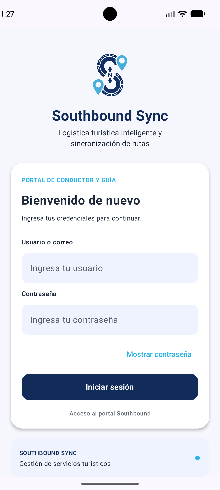

# Proyecto Lince — Southbound Sync

## 1. Descripción del proyecto

**Southbound Sync** es una aplicación móvil diseñada para los trabajadores de Southbound, empresa dedicada a servicios turísticos. Su propósito es facilitar la coordinación de los servicios turísticos y centralizar la información relacionada con ellos.

La aplicación considera tres roles de trabajadores: **Driver, Guía y Coordinador**.

## 2. Objetivo

Facilitar la coordinación de los servicios turísticos, mejorando el acceso a la información y la comunicación relacionada con las asignaciones y el estado de los servicios.

## 3. Tecnologías utilizadas

- Kotlin
- Android Studio
- Jetpack Compose
- Material Design 3
- Navigation Compose
- Arquitectura MVVM

## 4. Arquitectura del proyecto

El proyecto utiliza el patrón **MVVM (Model-View-ViewModel)** para organizar el código y separar las responsabilidades.

- **Model:** contiene las clases `Usuario` y `Servicio`.
- **View:** contiene las pantallas y los componentes visuales.
- **ViewModel:** administra los datos de ejemplo utilizados por las pantallas.

### Estructura principal

```text
cl.duoc.proyectolince
├── model
│   ├── Usuario.kt
│   └── Servicio.kt
├── navigation
│   └── LinceNavigation.kt
├── ui
│   ├── components
│   │   └── LinceBottomBar.kt
│   ├── screens
│   │   ├── LoginScreen.kt
│   │   ├── InicioScreen.kt
│   │   ├── ServiciosScreen.kt
│   │   └── PerfilScreen.kt
│   └── theme
├── viewmodel
│   └── LinceViewModel.kt
└── MainActivity.kt
```

## 5. Pantallas de la aplicación

### Login

Pantalla de inicio de sesión de la aplicación. En esta etapa, no se realiza una autenticación real.



### Inicio

Pantalla principal que permite acceder a las secciones de la aplicación.


### Servicios

Muestra una lista de servicios turísticos utilizando datos de ejemplo.


### Perfil

Muestra la información de ejemplo del trabajador actual.


## 6. Alcance de esta versión

Esta versión corresponde a un prototipo académico. Utiliza datos de ejemplo y navegación entre pantallas. Todavía no incluye una base de datos, autenticación real ni la gestión operativa real de asignaciones, disponibilidad o entradas y salidas de servicios.

## 7. Equipo de trabajo

**Equipo:** Surstromming  
**Sección:** 003D

- Benjamin Yovanovich — Backend
- Benjamin Sepulveda — Líder del proyecto
- Anibal Toledo — Frontend
